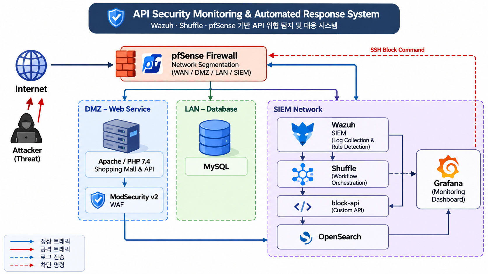
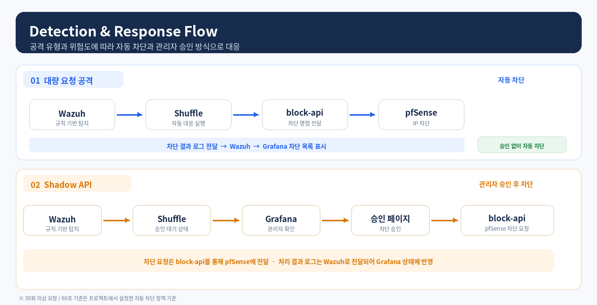

# 🛡️ API Security Monitoring & Automated Response System

**Wazuh · Shuffle · pfSense 기반 API 위협 탐지 및 대응 시스템**

> 웹 서비스에서 발생하는 비정상적인 API 요청을 탐지하고, IP 화이트리스트 확인 후 공격 유형에 따라 자동 차단 또는 관리자 승인 기반으로 대응하는 보안 모니터링 시스템입니다.

## 📌 Project Overview

웹 서비스가 운영되면서 발생하는 비정상적인 API 접근과 반복적인 요청을 탐지하고, 보안 이벤트에 대응할 수 있도록 시스템을 구축했습니다.

Wazuh의 룰 기반 로그 탐지를 중심으로 보안 이벤트를 수집하고, Shuffle에서 IP 화이트리스트 여부를 확인하여 대응 흐름을 분기하도록 구성했습니다. 이후 Custom block-api와 pfSense를 연동하여 자동 차단 및 관리자 승인 기반 대응을 수행합니다.

| 구분 | 내용 |
|:---|:---|
| 프로젝트 | API Security Monitoring & Automated Response |
| 개발 형태 | 팀 프로젝트 |
| 주요 목적 | API 위협 탐지 및 대응 체계 구현 |
| 대상 서비스 | PHP 기반 쇼핑몰 및 API 서버 |
| 주요 기술 | Wazuh, Shuffle, pfSense, Grafana |

## 🎯 Project Goals

- **API 위협 탐지** — Wazuh 룰을 활용한 비정상적인 요청 및 공격 이벤트 탐지
- **대응 프로세스 구성** — IP 화이트리스트 확인 후 공격 유형에 따라 자동 차단과 관리자 승인 방식으로 분기
- **네트워크 보안 강화** — pfSense를 활용한 네트워크 분리 및 IP 차단
- **보안 현황 시각화** — Grafana를 통한 탐지 이벤트 및 대응 상태 확인

## 🏗️ System Architecture

> 네트워크 구역을 분리하고, Wazuh의 로그 탐지부터 Shuffle의 대응 흐름 처리, block-api와 pfSense의 IP 차단까지 연결한 시스템 구성도입니다.

## ⚙️ Technology Stack

| Category | Technology | Role |
|:---|:---|:---|
| Web Server | Apache | 웹 서비스 운영 |
| Backend | PHP 7.4 | 쇼핑몰 및 API 서버 |
| Database | MySQL | 서비스 데이터 관리 |
| Firewall | pfSense | 네트워크 분리 및 IP 차단 |
| IPS | Suricata | 네트워크 침입 탐지 및 방지 |
| WAF | ModSecurity v2 | 웹 요청 필터링 |
| SIEM | Wazuh | 로그 수집 및 룰 기반 보안 이벤트 탐지 |
| Search Engine | OpenSearch | 이벤트 데이터 저장 및 조회 |
| Workflow Automation | Shuffle | IP 화이트리스트 확인 및 대응 흐름 분기·요청 전달 |
| Dashboard | Grafana | 탐지 이벤트 및 대응 현황 시각화 |
| Custom API | block-api | 차단 요청 수신 및 pfSense 차단 명령 전달 |

## 🔄 Detection & Response Flow

공격 유형과 위험도에 따라 자동 차단과 관리자 승인 방식으로 대응합니다.

### 1. 대량 요청 공격 — 자동 차단

- 프로젝트에서 설정한 기준: **60초 이내 30회 요청**
- Wazuh 룰을 통해 조건에 해당하는 이벤트 탐지
- Shuffle에서 IP 화이트리스트 여부 확인
- 화이트리스트에 등록되지 않은 IP에 대해 block-api로 차단 요청 전달
- block-api가 pfSense에 차단 명령 전달
- 차단 결과 상태를 Wazuh로 전달하고 Grafana에서 확인

### 2. Shadow API — 관리자 승인 후 차단

- Wazuh가 관련 로그를 룰 기반으로 탐지
- Shuffle에서 IP 화이트리스트 여부 확인
- 화이트리스트에 등록되지 않은 IP에 대해 승인 대기 상태 전달
- Grafana에서 승인 대기 항목 확인
- 관리자가 별도 승인 페이지에서 차단 여부 결정
- 승인 시 block-api가 pfSense에 차단 명령 전달
- 차단 결과 상태를 Wazuh로 전달하고 Grafana에서 확인

## 💡 Key Implementation

### 1. 공격 유형에 따른 대응 방식 분리

모든 탐지 이벤트를 자동 차단하면 정상적인 사용자의 요청까지 차단할 가능성이 있습니다.

이를 고려하여 대량 요청 공격과 Shadow API 이벤트의 대응 방식을 구분했습니다.

| 구분 | 대량 요청 공격 | Shadow API |
|:---|:---|:---|
| 대응 방식 | 자동 차단 | 관리자 승인 후 차단 |
| 판단 기준 | 설정된 요청 횟수 및 시간 조건 | 관리되지 않는 API 접근 이벤트 |
| 사전 확인 | Shuffle의 IP 화이트리스트 확인 | Shuffle의 IP 화이트리스트 확인 |
| 차단 실행 | 자동 차단 요청 | 관리자 승인 후 차단 요청 |
| 목적 | 신속한 대응 | 오탐으로 인한 피해 최소화 |

> **탐지 기준의 한계:** 30회/60초는 프로젝트에서 설정한 자동 차단 정책 기준이며, 이 기준만으로 모든 비정상 요청이나 자동화 공격을 정확하게 판별할 수 있는 것은 아닙니다.

### 2. Shuffle 기반 대응 흐름 구성

Shuffle은 Wazuh에서 전달받은 보안 이벤트를 바탕으로 대응 절차를 연결하는 역할을 담당합니다.

- 이벤트에 포함된 IP의 화이트리스트 등록 여부 확인
- 화이트리스트 등록 여부에 따른 대응 흐름 분기
- 대량 요청 공격에 대한 block-api 차단 요청 전달
- Shadow API 이벤트의 승인 대기 상태 전달
- 대응 상태 로그를 Wazuh로 전달

> 공격 탐지는 Wazuh의 룰을 통해 수행하며, Shuffle이 자체적으로 공격 여부나 위험도를 분석하는 구조는 아닙니다.

### 3. Custom block-api 개발

폐쇄망 환경에서 외부 서비스 및 메신저 연동에 제약이 있어, 방화벽 차단 명령을 전달하는 별도의 block-api를 구현했습니다.

- Shuffle 및 관리자 승인 페이지로부터 차단 요청 수신
- pfSense에 SSH 기반 차단 명령 전달
- 차단 요청과 실제 방화벽 동작 연결

### 4. Grafana 기반 대응 현황 시각화

Wazuh에서 처리되는 보안 이벤트와 대응 상태를 Grafana 대시보드에서 확인할 수 있도록 구성했습니다.

- 탐지 이벤트 확인
- 승인 대기 항목 확인
- 차단 완료 항목 확인
- 대응 상태 변화 모니터링

## 🎬 Project Demo

https://github.com/user-attachments/assets/c6d7a6d5-50c4-4856-b5b6-94ae58189ef0

## 🔧 Project Considerations & Limitations

### 폐쇄망 환경에 따른 대응 구조 변경

초기에는 Shuffle을 활용해 공격 알림을 내부 메신저로 전달하고, 관리자가 메신저에서 차단 여부를 선택하는 형태를 구상했습니다.

하지만 폐쇄망 환경에서 외부 서비스 및 메신저 연동에 제약이 발생했습니다. 이에 따라 별도의 block-api와 관리자 승인 페이지를 개발하여 대응 구조를 변경했습니다.

### 개선 방향

- 요청 횟수뿐 아니라 사용자 및 IP별 정상 트래픽 패턴을 고려한 탐지 기준 개선
- 정상적인 서비스 요청이 차단되는 오탐 상황을 줄이기 위한 예외 처리
- 차단 시간 설정 및 차단 해제 기능 보완
- 공격 유형별 탐지 룰과 대응 정책 세분화

## 👥 Project Outcome

이번 프로젝트를 통해 웹 서비스에서 발생하는 로그를 수집하고, 탐지 룰을 기반으로 보안 이벤트를 생성한 뒤 대응 시스템과 연동하는 과정을 경험했습니다.

특히 Wazuh의 탐지 이벤트를 Shuffle의 화이트리스트 확인 및 대응 흐름과 연결하고, Custom block-api와 pfSense를 통해 실제 IP 차단까지 이어지는 구조를 구현했습니다.

**주요 경험**

- Wazuh 룰 기반 로그 탐지 및 이벤트 처리
- Shuffle을 활용한 IP 화이트리스트 확인 및 대응 흐름 구성
- pfSense 방화벽 연동 및 IP 차단
- Custom block-api 및 관리자 승인 페이지 구현
- Grafana 기반 보안 이벤트 및 대응 상태 모니터링

---

**Information Security Project | Team Project**
